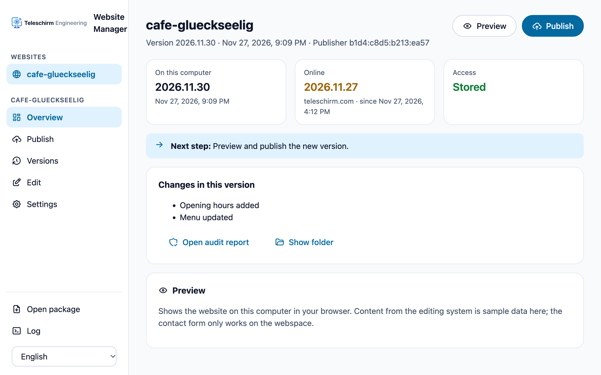

# Website Manager

A desktop app that lets website owners open a website package delivered by their web agency,
preview it locally and upload it to their own webspace – no technical knowledge needed.



> Version 0.4.0 (new user interface, bundled PHP/rclone). Changes: [CHANGELOG.md](CHANGELOG.md) ·
> Architecture: [docs/architecture.md](docs/architecture.md) · Spike report: [docs/spike/phase-0.md](docs/spike/phase-0.md).

## Download

Installers for Windows, macOS and Linux are attached to the
[releases](https://github.com/MrMarteng/website_manager/releases). They are not signed yet; see the
notes in each release. Verify downloads with `SHA256SUMS`.

## How it works

1. The agency creates a signed package (`.tsweb`) with `website-manager pack`.
2. The customer opens it in the Website Manager. Signature and checksums are verified; the first
   package binds its publisher to the website, later packages from other publishers are rejected.
3. **Preview:** the built website runs locally (PHP on `127.0.0.1`, sandboxed) in the browser.
4. **Upload:** according to the rules of the shipped `deploy.conf` via SFTP/FTPS (rclone);
   content from the editing system on the server stays untouched.

The app's user interface is available in German and English.

## Structure

| Folder | Content |
|---|---|
| `crates/core` | Package format, signatures (Ed25519), checksums, publisher binding, secret detection, projects, credentials, Node.js runtime |
| `crates/deploy` | `teleschirm-deploy`: reads `deploy.conf`, plans and runs the upload with rclone |
| `crates/cli` | Program `website-manager`: `keygen`, `pack`, `verify`, `deploy`, `node` |
| `apps/desktop` | Tauri app (Rust + UI in TypeScript with Vite, German/English) |
| `docs/formats` | Specification of `.tsweb`, manifest, `website-manager.config.json`, `deploy.conf` |

## Development

Requirements: Rust (stable), Node.js (Tauri CLI and the UI build) and Python 3 (to fetch the bundled
programs). `npm run dev` uses PHP ≥ 8.2 and rclone from the `PATH` (or `WM_PHP`/`WM_RCLONE`);
installers ship their own copies, fetched with `npm run sidecars` and built with
`npm run build:release`.

```bash
cargo test --workspace
cargo clippy --workspace --all-targets -- -D warnings
cd apps/desktop && npm install && npm test && npm run dev
```

`npm run ui:mock` serves the user interface with sample data in a normal browser
(`http://127.0.0.1:1421`), without Rust; the screenshot above comes from it.

The workflow `.github/workflows/build.yml` builds installers for Windows, macOS and Linux on
GitHub (on tags `v*` or via "Run workflow"); on every push it checks formatting, Clippy and tests.
Testing on Windows: [docs/windows-test.md](docs/windows-test.md).

## Creating a package (agency)

```bash
website-manager keygen --out ~/.config/website-manager/keys     # once; back up the secret key
website-manager pack --project <website> --key ~/.config/website-manager/keys/signing.key
# First delivery including webspace access (send the package password separately):
WM_PACKAGE_PASSWORD='…' website-manager pack --project <website> --key … --credentials access.json
website-manager verify <package>.tsweb
```

The project needs a `website-manager.config.json`, see [docs/formats/package.md](docs/formats/package.md).

## License

Apache License 2.0, see [LICENSE](LICENSE). Name and logo are not licensed, see
[TRADEMARKS.md](TRADEMARKS.md). Contributing: [CONTRIBUTING.md](CONTRIBUTING.md) ·
Security: [SECURITY.md](SECURITY.md) · [Code of conduct](CODE_OF_CONDUCT.md).
