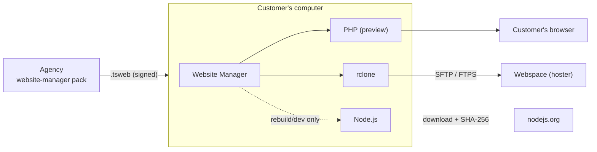
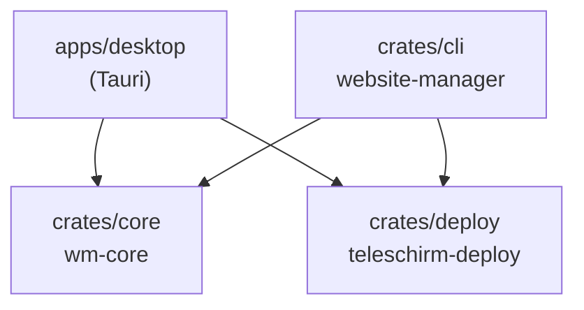
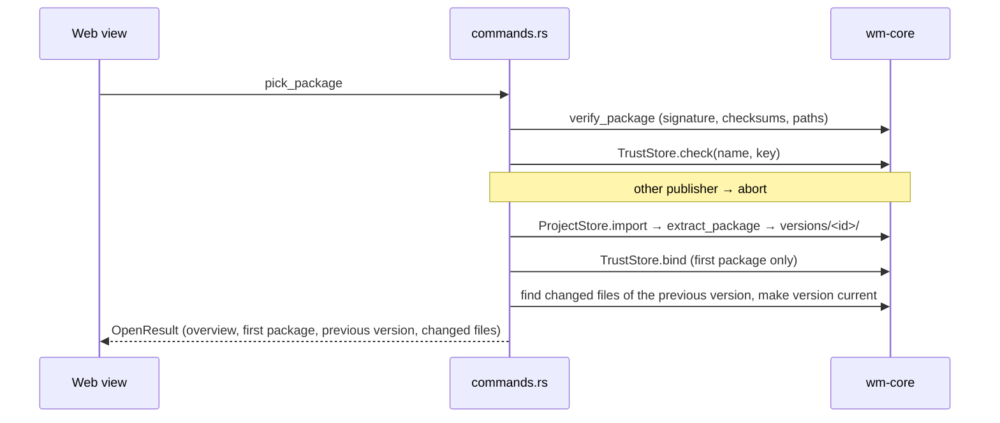

# Architecture

Describes the current state of the current version (see [CHANGELOG.md](../CHANGELOG.md)).
Structure loosely follows arc42, cut down to the essentials. Maintenance: [CONTRIBUTING.md](../CONTRIBUTING.md).

## 1. Purpose and context

The Website Manager brings a website built by the agency to the customer and from there to the
customer's webspace. The customer needs neither technical knowledge nor installed developer tools.

| Neighbour system | Interface |
|---|---|
| Agency | creates packages with the CLI, holds the signing key |
| Webspace | SFTP (password or key) or FTPS; no shell access needed |
| Browser | opens the local preview `http://127.0.0.1:<port>/` |
| nodejs.org | official Node.js builds, only for rebuild and development mode |

## 2. Quality goals

| Priority | Goal | Implementation |
|---|---|---|
| 1 | **Security** – a package must not run anything the publisher did not sign | signature, checksums, publisher binding, sandboxing (section 6) |
| 2 | **No data loss** on the server | `protect`/`seed` from `deploy.conf`, version file |
| 3 | **Simplicity** for non-experts | core workflow without Node.js, three steps: open, preview, upload |
| 4 | **Platforms** macOS, Windows, Linux | Tauri, logic in Rust, no shell calls |
| 5 | **Independence** | no dependency on agency infrastructure; open formats |

## 3. Constraints

* License Apache 2.0; name and logo not licensed (`TRADEMARKS.md`).
* Rust (stable) for all logic, user interface in HTML/JS without framework; Rust guideline in
  `CONTRIBUTING.md`.
* `deploy.conf` stays compatible with `deploy.sh`.
* No code from AGPL projects.

## 4. Building blocks

Dependencies only point downwards; `core` and `deploy` do not know each other.

| Building block | Responsibility | Main modules |
|---|---|---|
| `wm-core` | package format, trust, projects | `archive` (write, verify, extract), `manifest`, `signing` (Ed25519), `trust` (publisher binding), `secrets` (secret detection), `credentials` (credential encryption), `projects` (versions, settings), `runtime::node` (download, verification, cache) |
| `teleschirm-deploy` | upload | `config` (`deploy.conf` parser, change of the target folder), `plan` (rclone arguments per mapping), `runner` (execution, seed check, version file), `changes` (uploaded/deleted files from rclone output) |
| `website-manager` (CLI) | agency tool | `keygen`, `pack` (positive list, cleaned `deploy.conf`, host keys, encrypted credentials, `vendor`: private npm packages as tarballs), `verify`, `deploy`, `node` |
| `apps/desktop` | customer UI | `commands` (only interface to the web view), `overview` (project view), `deployment` (apply settings, upload), `keychain` (OS keychain), `files` (file list), `site` (rebuild, development mode), `preview` + `router.php`, `tools` (locating PHP/rclone); `lib` accepts packages by double-click, second app start and drag and drop |

## 5. Flows

**Create a package** (`pack`): build → files by positive list → `deploy.conf` without key paths,
for SFTP with the server's host keys (`ssh-keyscan`, file `known_hosts`) → optionally encrypted
credentials (`credentials.enc`) → secret detection → SHA-256 per file into the manifest → sign the
manifest → write the ZIP. A secret finding aborts before any file is written.

**Open a package:**

An update replaces the current version; the previous version is kept (at most five, older ones go
to the trash). Settings and credentials live outside the versions and are kept. If the package
contains credentials, the app decrypts them with the package password and stores them in the
keychain.

**Preview:** free port on `127.0.0.1` → `php -S` with `dist/` as root, `router.php`, `open_basedir`
limited to the package folder and disabled process functions → wait until the port answers → open
the default browser. Quitting the app stops PHP.

**Upload:** load the current version's `deploy.conf` (base = version folder) → apply the
customer's settings (server, user, port, target folder, own mappings in expert mode) → server
identity: the recorded host key only applies to the server from the package, otherwise a
confirmation is required → access: entered password or keychain (SSH key as a temporary file with
0600, deleted after the run) → read the version file from the server; if it is newer, continue only
after confirmation → rclone per mapping (`seed`: only into empty targets, `protect`: neither
uploaded nor deleted), every line as an event to the window → finally write `.website-manager.json`.
"Upload now" always runs a dry run (`--dry-run`) first and asks with the number of new and deleted
files.

**Rebuild:** resolve the Node.js version named in the manifest (exact like `22.23.5`, a major
version like `22` or `lts`; without one the newest LTS) – major versions and `lts` resolve to the
newest matching release on nodejs.org, offline to the newest matching cached release – then
download and verify it → refuse with a clear message if the lockfile still points at a private
registry → in `project/` run `npm ci --ignore-scripts` if `node_modules` is missing or older than
the lockfile → run the `build` script from `package.json` without a shell (`KEY=value program args`;
`program` is resolved through the package's `bin` field to its JavaScript file and started with
the downloaded Node.js) → the output (`build_output`, default `dist`) replaces the version's
`dist/`, the previous `dist/` is kept in `.runtime/dist-before-build/` → Node.js versions no longer
needed are removed from the cache.

**Development mode:** like rebuild up to the script, then `dev` in its own process group (with
`--ignore-lock` for `astro dev`); the first local address in the output is opened in the browser.
Stopping ends the whole group (`TERM` first, `KILL` after 5 s; Windows: `taskkill /T`), also when
the app is closed.

**Restore:** an earlier version becomes current again and is then uploaded like any version; the
question about the newer version on the server is expected here.

## 6. Security concept

The trust boundary is the package file: everything in it is untrusted until verification passes.

| Threat | Measure | Where |
|---|---|---|
| modified or substituted package | Ed25519 signature over the manifest, SHA-256 of every file, no unlisted files | `archive` |
| other publisher sends an "update" | binding project name → key on the first package (TOFU); hard rejection later | `trust` |
| path traversal when extracting | only relative normal paths, no links, extraction through a staging folder | `archive::safe_relative_path` |
| code execution when opening | the core workflow runs no package code; rebuild and development mode only on click, with `npm ci --ignore-scripts`; npm scripts without a shell (scripts with `&&`, `\|`, redirections are rejected) | flow, `site` |
| orphaned processes after development mode | own process group, the whole group is stopped | `site` |
| PHP code of the preview | `127.0.0.1` only, `open_basedir`, `disable_functions`, `.htaccess` restrictions via router | `preview`, `router.php` |
| compromised web view | Tauri capability `core:default` only, strict CSP, files/processes/dialogs only in Rust; folders from the web view are checked against the app data folder | `capabilities/`, `commands` |
| password in process list or log | handed to rclone obscured via environment variable, never as argument; the user's own `rclone.conf` is ignored | `plan`, `runner` |
| secrets in the package | positive list, checks of names and content markers, key paths removed from `deploy.conf` | `secrets`, `pack` |
| credentials in the package intercepted | Argon2id (64 MiB, 3 passes) + AES-256-GCM with package password; package password sent another way; the file is signed and cannot be swapped | `credentials` |
| credentials on the computer | only in the operating system's keychain; export only re-encrypted with an own password | `keychain`, `commands` |
| man-in-the-middle on upload | host key from the package (`known_hosts`) for SFTP; without a matching key only after explicit confirmation | `pack`, `deployment` |
| older package overwrites newer one | version file on the server, confirmation | `deployment` |

## 7. Data and storage

| Data | Location | Content |
|---|---|---|
| package | anywhere | `.tsweb`, see `docs/formats/package.md` |
| project | app data folder `projects/<name>/project.json` | current version, version list, customer settings, marker `credentialsStored` |
| versions | app data folder `projects/<name>/versions/<version>_<created>/` | extracted package, manifest copy, `.runtime/` (router, sessions, temp, temporary key) |
| credentials | keychain, service `com.teleschirm.website-manager`, account = project name | password and/or SSH key (JSON); read only when uploading, at most once per project and session (then from memory) |
| credentials export | anywhere, `<name>.wmzugang` | like `credentials.enc`, with transfer password |
| publisher binding | app data folder `trust.json` | project name → public key |
| Node.js runtimes | app cache folder `node/node-v<version>-<os>-<arch>/` | one folder per version; only versions of current project versions are kept |
| previous build | version `.runtime/dist-before-build/` | `dist/` before the last rebuild |
| version file | website root on the server | `.website-manager.json`: name, version, `created` |
| signing key | agency computer only | `signing.key` (0600), `signing.pub` |

App data folder on macOS: `~/Library/Application Support/com.teleschirm.website-manager/`.

## 8. Decisions

| Decision | Reason | Rejected |
|---|---|---|
| Tauri 2 + Rust | small installers (DMG 3.6 MB), little RAM, one logic for app and CLI | Electron (≈ 200 MB), Wails (Go) |
| built website in the package | the customer uploads what was tested; no Node.js in the core workflow | building at the customer |
| rclone instead of own SFTP logic | proven sync, SFTP and FTPS, works without a shell on the server | own library |
| publisher binding (TOFU) | works without a certificate authority, also for other agencies | keys built into the program |
| PHP built-in server + router | one program, sandboxed via `-d`; `.htaccess` emulated by the router | shipping Apache/nginx |
| UI without framework | few views, no build step, small attack surface | React/Vue |
| credentials in the keychain | protected by the operating system, no own master password | encrypted file in the app folder |
| versions instead of server backup | fast, no download; restore = upload again | backing up the webspace before every upload |

## 9. Known limitations

Measurements and findings of the feasibility study: [spike/phase-0.md](spike/phase-0.md).

* Tested on macOS only; Windows and Linux are untested.
* PHP and rclone are not shipped; the app uses `WM_PHP`/`WM_RCLONE` or the `PATH`.
* Without a host key in the package (or with a changed server) rclone does not verify the server's
  identity; the app requires a confirmation for that.
* Without a reachable keychain (Linux without Secret Service) the password is entered on every
  upload.
* Versions only back up the package contents; content from the editing system on the server is not
  backed up.
* The npm scripts `build` and `dev` must work without a shell (only `KEY=value program args`).
* Node.js checksums (`SHASUMS256.txt`) are fetched over HTTPS; their GPG signature is not verified.
* Rebuild and development mode need internet access the first time (Node.js, npm packages).
