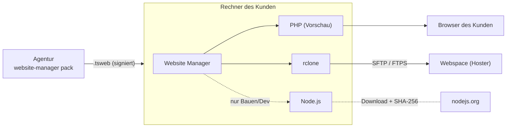
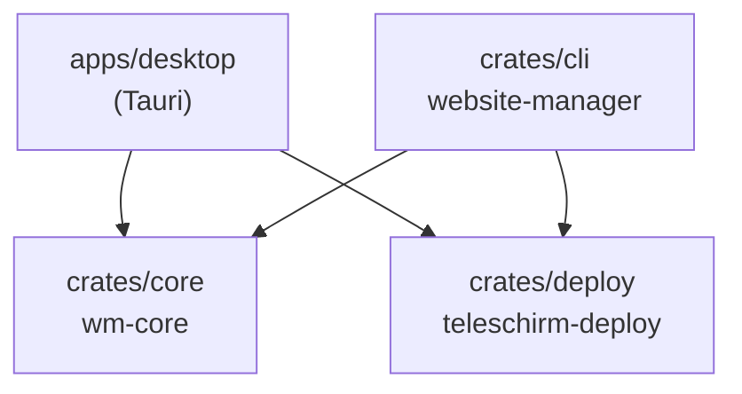
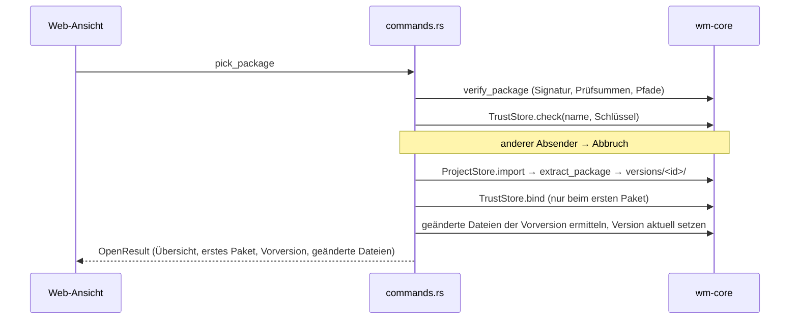

# Architektur

Beschreibt den Ist-Zustand der aktuellen Version (siehe [CHANGELOG.md](../CHANGELOG.md)).
Gliederung angelehnt an arc42, auf das Wesentliche gekürzt. Pflege: [CONTRIBUTING.md](../CONTRIBUTING.md).

## 1. Zweck und Kontext

Der Website Manager bringt eine von der Agentur gebaute Website zum Kunden und von dort auf dessen
Webspace. Der Kunde braucht kein technisches Wissen und keine installierten Entwicklerwerkzeuge.

| Nachbarsystem | Schnittstelle |
|---|---|
| Agentur | erzeugt Pakete mit der CLI, hält den Signaturschlüssel |
| Webspace | SFTP (Passwort oder Schlüssel) oder FTPS; kein Shell-Zugang nötig |
| Browser | öffnet die lokale Vorschau `http://127.0.0.1:<port>/` |
| nodejs.org | offizielle Node-Builds, nur für Bauen und Dev-Modus |

## 2. Qualitätsziele

| Priorität | Ziel | Umsetzung |
|---|---|---|
| 1 | **Sicherheit** – ein Paket darf nichts ausführen, was der Absender nicht signiert hat | Signatur, Prüfsummen, Absender-Bindung, Abschottung (Abschnitt 6) |
| 2 | **Kein Datenverlust** auf dem Server | `protect`/`seed` aus der `deploy.conf`, Versionsdatei |
| 3 | **Einfachheit** für Laien | Kernablauf ohne Node, drei Schritte: öffnen, ansehen, hochladen |
| 4 | **Plattformen** macOS, Windows, Linux | Tauri, reine Rust-Logik, keine Shell-Aufrufe |
| 5 | **Eigenständigkeit** | keine Abhängigkeit zu Agentur-Infrastruktur; offene Formate |

## 3. Randbedingungen

* Lizenz Apache 2.0; Name und Logo nicht lizenziert (`TRADEMARKS.md`).
* Rust (stable) für alle Logik, Oberfläche in HTML/JS ohne Framework; Rust-Guideline in `CONTRIBUTING.md`.
* `deploy.conf` bleibt kompatibel zu `deploy.sh`.
* Kein Code aus AGPL-Projekten.

## 4. Bausteine

Abhängigkeiten zeigen nur nach unten; `core` und `deploy` kennen sich nicht.

| Baustein | Verantwortung | Wichtige Module |
|---|---|---|
| `wm-core` | Paketformat, Vertrauen, Projekte | `archive` (schreiben, prüfen, entpacken), `manifest`, `signing` (Ed25519), `trust` (Absender-Bindung), `secrets` (Geheimnis-Prüfung), `credentials` (Verschlüsselung der Zugangsdaten), `projects` (Versionen, Einstellungen), `runtime::node` (Download, Prüfung, Cache) |
| `teleschirm-deploy` | Upload | `config` (Parser `deploy.conf`, Wechsel des Zielordners), `plan` (rclone-Argumente je Zuordnung), `runner` (Ausführung, Seed-Prüfung, Versionsdatei), `changes` (hochgeladene/gelöschte Dateien aus der rclone-Ausgabe) |
| `website-manager` (CLI) | Werkzeug der Agentur | `keygen`, `pack` (Positivliste, Bereinigung der `deploy.conf`, Host-Schlüssel, verschlüsselte Zugangsdaten, `vendor`: private npm-Pakete als Tarball), `verify`, `deploy`, `node` |
| `apps/desktop` | Oberfläche des Kunden | `commands` (einzige Schnittstelle zur Web-Ansicht), `overview` (Projektansicht), `deployment` (Einstellungen anwenden, Upload), `keychain` (Schlüsselbund), `files` (Dateiliste), `site` (Neu bauen, Entwicklungsmodus), `preview` + `router.php`, `tools` (Auffinden von PHP/rclone); `lib` nimmt Pakete per Doppelklick, zweitem Programmstart und Ziehen ins Fenster an |

## 5. Abläufe

**Paket erstellen** (`pack`): Build → Dateien nach Positivliste → `deploy.conf` ohne Schlüsselpfade,
bei SFTP mit den Host-Schlüsseln des Servers (`ssh-keyscan`, Datei `known_hosts`) → optional
Zugangsdaten verschlüsselt (`credentials.enc`) → Geheimnis-Prüfung → SHA-256 je Datei ins Manifest →
Manifest signieren → ZIP schreiben. Ein Geheimnis-Fund bricht ab, bevor eine Datei entsteht.

**Paket öffnen:**

Ein Update ersetzt die aktuelle Version; die Vorversion bleibt erhalten (höchstens fünf, ältere in
den Papierkorb). Einstellungen und Zugangsdaten liegen außerhalb der Versionen und bleiben.
Enthält das Paket Zugangsdaten, entschlüsselt die App sie mit dem Paketpasswort und legt sie im
Schlüsselbund ab.

**Ansehen:** freier Port auf `127.0.0.1` → `php -S` mit `dist/` als Wurzel, `router.php`,
`open_basedir` auf den Paketordner und gesperrten Prozessfunktionen → warten, bis der Port antwortet
→ Standardbrowser öffnen. Beim Beenden der App wird PHP gestoppt.

**Hochladen:** `deploy.conf` der aktuellen Version laden (Basis = Versionsordner) → Einstellungen
des Kunden anwenden (Server, Benutzer, Port, Zielordner, im Expertenmodus eigene Zuordnungen) →
Server-Identität: hinterlegter Host-Schlüssel gilt nur für den Server aus dem Paket, sonst ist eine
Bestätigung nötig → Zugang: eingegebenes Passwort oder Schlüsselbund (SSH-Schlüssel als temporäre
Datei mit 0600, nach dem Lauf gelöscht) → Versionsdatei vom Server lesen; ist sie neuer, nur nach
Rückfrage weiter → je Zuordnung rclone (`seed`: nur in leere Ziele, `protect`: weder hochladen noch
löschen), jede Zeile als Ereignis an das Fenster → zuletzt `.website-manager.json` schreiben.
„Jetzt hochladen“ macht immer erst einen Prüflauf (`--dry-run`) und fragt mit der Zahl der neuen und
gelöschten Dateien nach.

**Neu bauen:** Node.js der im Manifest genannten Version (sonst 22.12.0) laden und prüfen → in
`project/` `npm ci --ignore-scripts`, falls `node_modules` fehlt oder älter als das Lockfile ist →
Skript `build` aus `package.json` ohne Shell ausführen (`KEY=wert programm argumente`; `programm`
wird über das `bin`-Feld des Pakets zur JavaScript-Datei aufgelöst und mit dem geladenen Node
gestartet) → die Ausgabe (`build_output`, Standard `dist`) ersetzt `dist/` der Version, das
vorherige `dist/` bleibt in `.runtime/dist-before-build/` → nicht mehr benötigte Node-Versionen
werden aus dem Cache gelöscht.

**Entwicklungsmodus:** wie „Neu bauen“ bis zum Skript, dann `dev` in eigener Prozessgruppe (bei
`astro dev` mit `--ignore-lock`); die erste lokale Adresse in der Ausgabe wird im Browser
geöffnet. Beenden stoppt die ganze Gruppe (erst `TERM`, nach 5 s `KILL`; Windows: `taskkill /T`),
auch beim Schließen der App.

**Wiederherstellen:** eine frühere Version wird wieder aktuell und anschließend wie jede Version
hochgeladen; die Rückfrage wegen der neueren Version auf dem Server ist dabei erwartet.

## 6. Sicherheitskonzept

Vertrauensgrenze ist die Paketdatei: Alles darin gilt als fremd, bis die Prüfung bestanden ist.

| Bedrohung | Maßnahme | Ort |
|---|---|---|
| verändertes oder untergeschobenes Paket | Ed25519-Signatur über das Manifest, SHA-256 jeder Datei, keine nicht gelisteten Dateien | `archive` |
| fremder Absender schickt „Update“ | Bindung Projektname → Schlüssel beim ersten Paket (TOFU); später harte Ablehnung | `trust` |
| Pfad-Ausbruch beim Entpacken | nur relative Normalpfade, keine Links, Entpacken in Zwischenordner | `archive::safe_relative_path` |
| Code-Ausführung beim Öffnen | Kernablauf führt keinen Paket-Code aus; Bauen und Entwicklungsmodus nur auf Klick, mit `npm ci --ignore-scripts`; npm-Skripte ohne Shell (Skripte mit `&&`, `|`, Umleitungen werden abgelehnt) | Ablauf, `site` |
| verwaiste Prozesse nach dem Entwicklungsmodus | eigene Prozessgruppe, Beenden der ganzen Gruppe | `site` |
| PHP-Code der Vorschau | nur `127.0.0.1`, `open_basedir`, `disable_functions`, `.htaccess`-Sperren per Router | `preview`, `router.php` |
| Web-Ansicht wird kompromittiert | Tauri-Capability nur `core:default`, strikte CSP, Dateien/Prozesse/Dialoge nur in Rust; Ordner aus der Web-Ansicht werden gegen den App-Datenordner geprüft | `capabilities/`, `commands` |
| Passwort in Prozessliste oder Log | Übergabe an rclone verschleiert über Umgebungsvariable, nie als Argument; eigene `rclone.conf` des Nutzers wird ignoriert | `plan`, `runner` |
| Geheimnisse im Paket | Positivliste, Prüfung auf Namen und Inhaltsmerkmale, Schlüsselpfade aus `deploy.conf` entfernt | `secrets`, `pack` |
| Zugangsdaten im Paket abgefangen | Argon2id (64 MiB, 3 Durchläufe) + AES-256-GCM mit Paketpasswort; Paketpasswort auf anderem Weg; Datei ist signiert und kann nicht getauscht werden | `credentials` |
| Zugangsdaten auf dem Rechner | nur im Schlüsselbund des Betriebssystems; Export nur neu verschlüsselt mit eigenem Passwort | `keychain`, `commands` |
| Man-in-the-Middle beim Upload | Host-Schlüssel aus dem Paket (`known_hosts`) für SFTP; ohne passenden Schlüssel nur nach ausdrücklicher Bestätigung | `pack`, `deployment` |
| älteres Paket überschreibt neueres | Versionsdatei auf dem Server, Rückfrage | `deployment` |

## 7. Daten und Ablage

| Daten | Ort | Inhalt |
|---|---|---|
| Paket | beliebig | `.tsweb`, siehe `docs/formate/paket.md` |
| Projekt | App-Datenordner `projects/<name>/project.json` | aktuelle Version, Versionsliste, Einstellungen des Kunden, Merker `credentialsStored` |
| Versionen | App-Datenordner `projects/<name>/versions/<version>_<created>/` | entpacktes Paket, Kopie des Manifests, `.runtime/` (Router, Sessions, Temp, temporärer Schlüssel) |
| Zugangsdaten | Schlüsselbund, Dienst `com.teleschirm.website-manager`, Konto = Projektname | Passwort und/oder SSH-Schlüssel (JSON); gelesen erst beim Upload, höchstens einmal je Projekt und Sitzung (danach aus dem Speicher) |
| Zugangs-Export | beliebig, `<name>.wmzugang` | wie `credentials.enc`, mit Übertragungspasswort |
| Absender-Bindung | App-Datenordner `trust.json` | Projektname → öffentlicher Schlüssel |
| Node-Laufzeiten | App-Cache-Ordner `node/node-v<version>-<os>-<arch>/` | ein Ordner je Version; nur Versionen aktueller Projektversionen bleiben |
| vorheriger Build | Version `.runtime/dist-before-build/` | `dist/` vor dem letzten „Neu bauen“ |
| Versionsdatei | Website-Wurzel auf dem Server | `.website-manager.json`: Name, Version, `created` |
| Signaturschlüssel | nur Rechner der Agentur | `signing.key` (0600), `signing.pub` |

App-Datenordner unter macOS: `~/Library/Application Support/com.teleschirm.website-manager/`.

## 8. Entscheidungen

| Entscheidung | Begründung | Verworfen |
|---|---|---|
| Tauri 2 + Rust | kleine Installer (DMG 3,6 MB), wenig RAM, eine Logik für App und CLI | Electron (≈ 200 MB), Wails (Go) |
| Fertige Website im Paket | Kunde lädt hoch, was getestet wurde; kein Node im Kernablauf | Bauen beim Kunden |
| rclone statt eigener SFTP-Logik | erprobter Abgleich, SFTP und FTPS, läuft ohne Shell auf dem Server | eigene Bibliothek |
| Absender-Bindung (TOFU) | funktioniert ohne Zertifizierungsstelle, auch für andere Agenturen | feste Schlüssel im Programm |
| PHP-Built-in-Server + Router | ein Programm, abschottbar per `-d`; `.htaccess` per Router nachgebildet | Apache/nginx mitliefern |
| Oberfläche ohne Framework | wenige Ansichten, kein Build-Schritt, kleine Angriffsfläche | React/Vue |
| Zugangsdaten im Schlüsselbund | Schutz durch das Betriebssystem, kein eigenes Master-Passwort | verschlüsselte Datei im App-Ordner |
| Versionen statt Server-Backup | schnell, ohne Download; Wiederherstellen = erneut hochladen | Sicherung des Webspace vor jedem Upload |

## 9. Bekannte Einschränkungen

Messwerte und Befunde der Machbarkeitsprüfung: [spike/phase-0.md](spike/phase-0.md).

* Getestet ist nur macOS; Windows und Linux sind ungeprüft.
* PHP und rclone werden nicht mitgeliefert; die App nutzt `WM_PHP`/`WM_RCLONE` oder den `PATH`.
* Ohne Host-Schlüssel im Paket (oder bei geändertem Server) prüft rclone die Server-Identität
  nicht; die App verlangt dafür eine Bestätigung.
* Ist kein Schlüsselbund erreichbar (Linux ohne Secret Service), wird das Passwort bei jedem Upload
  eingegeben.
* Versionen sichern nur die Paketinhalte; Inhalte aus dem Redaktionssystem auf dem Server werden
  nicht gesichert.
* npm-Skripte `build` und `dev` müssen ohne Shell auskommen (nur `KEY=wert programm argumente`).
* Node.js-Prüfsummen (`SHASUMS256.txt`) kommen per HTTPS, ihre GPG-Signatur wird nicht geprüft.
* Bauen und Entwicklungsmodus brauchen beim ersten Mal Internet (Node.js, npm-Pakete).
