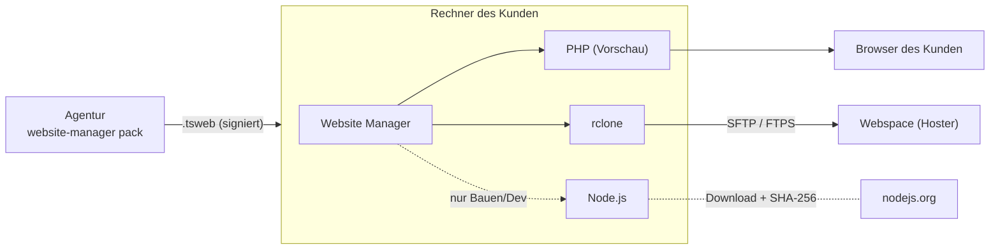
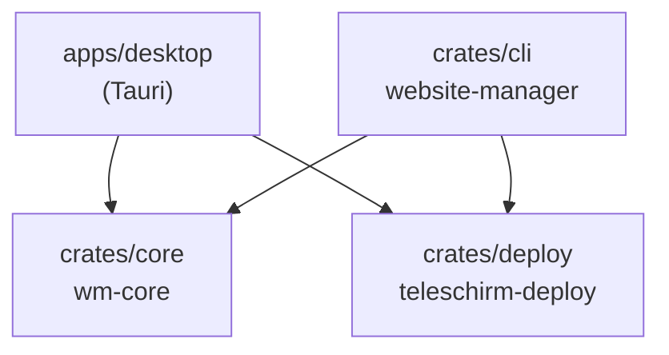
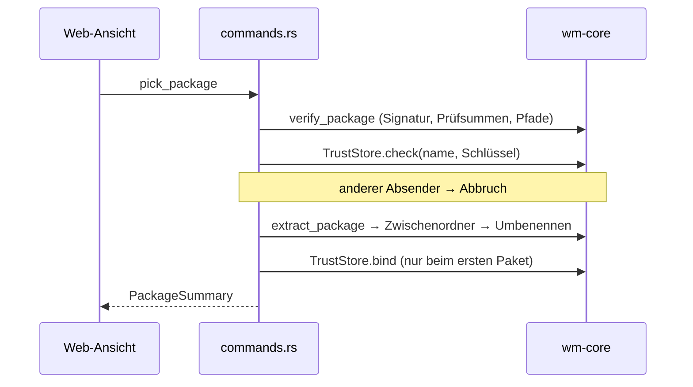

# Architektur

Stand: Phase 0 (27.11.2026). Gliederung angelehnt an arc42, auf das Wesentliche gekürzt.

## 1. Zweck und Kontext

Der Website Manager bringt eine von der Agentur gebaute Website zum Kunden und von dort auf dessen
Webspace. Der Kunde braucht kein technisches Wissen und keine installierten Entwicklerwerkzeuge.

| Nachbarsystem | Schnittstelle |
|---|---|
| Agentur | erzeugt Pakete mit der CLI, hält den Signaturschlüssel |
| Webspace | SFTP (Passwort oder Schlüssel) oder FTPS; kein Shell-Zugang nötig |
| Browser | öffnet die lokale Vorschau `http://127.0.0.1:<port>/` |
| nodejs.org | offizielle Node-Builds, nur für Bauen und Dev-Modus |

## 2. Qualitätsziele

| Priorität | Ziel | Umsetzung |
|---|---|---|
| 1 | **Sicherheit** – ein Paket darf nichts ausführen, was der Absender nicht signiert hat | Signatur, Prüfsummen, Absender-Bindung, Abschottung (Abschnitt 6) |
| 2 | **Kein Datenverlust** auf dem Server | `protect`/`seed` aus der `deploy.conf`, Versionsdatei |
| 3 | **Einfachheit** für Laien | Kernablauf ohne Node, drei Schritte: öffnen, ansehen, hochladen |
| 4 | **Plattformen** macOS, Windows, Linux | Tauri, reine Rust-Logik, keine Shell-Aufrufe |
| 5 | **Eigenständigkeit** | keine Abhängigkeit zu Agentur-Infrastruktur; offene Formate |

## 3. Randbedingungen

* Lizenz Apache 2.0; Name und Logo nicht lizenziert (`TRADEMARKS.md`).
* Rust (stable) für alle Logik, Oberfläche in HTML/JS ohne Framework; Rust-Guideline in `CONTRIBUTING.md`.
* `deploy.conf` bleibt kompatibel zu `deploy.sh`.
* Kein Code aus AGPL-Projekten.

## 4. Bausteine

Abhängigkeiten zeigen nur nach unten; `core` und `deploy` kennen sich nicht.

| Baustein | Verantwortung | Wichtige Module |
|---|---|---|
| `wm-core` | Paketformat und Vertrauen | `archive` (schreiben, prüfen, entpacken), `manifest`, `signing` (Ed25519), `trust` (Absender-Bindung), `secrets` (Geheimnis-Prüfung), `runtime::node` (Download, Prüfung, Cache) |
| `teleschirm-deploy` | Upload | `config` (Parser `deploy.conf`), `plan` (rclone-Argumente je Zuordnung), `runner` (Ausführung, Seed-Prüfung, Versionsdatei) |
| `website-manager` (CLI) | Werkzeug der Agentur | `keygen`, `pack` (Positivliste, Bereinigung der `deploy.conf`), `verify`, `deploy`, `node` |
| `apps/desktop` | Oberfläche des Kunden | `commands` (einzige Schnittstelle zur Web-Ansicht), `packages`, `preview` + `router.php`, `upload`, `tools` (Auffinden von PHP/rclone) |

## 5. Abläufe

**Paket erstellen** (`pack`): Build → Dateien nach Positivliste → Geheimnis-Prüfung → SHA-256 je
Datei ins Manifest → Manifest signieren → ZIP schreiben. Ein Geheimnis-Fund bricht ab, bevor eine
Datei entsteht.

**Paket öffnen:**

**Ansehen:** freier Port auf `127.0.0.1` → `php -S` mit `dist/` als Wurzel, `router.php`,
`open_basedir` auf den Paketordner und gesperrten Prozessfunktionen → warten, bis der Port antwortet
→ Standardbrowser öffnen. Beim Beenden der App wird PHP gestoppt.

**Hochladen:** `deploy.conf` laden (Basis = Paketordner) → Versionsdatei vom Server lesen; ist sie
neuer als das Paket, nur nach Rückfrage weiter → je Zuordnung rclone (`seed`: nur in leere Ziele,
`protect`: weder hochladen noch löschen) → zuletzt `.website-manager.json` schreiben. „Änderungen
prüfen“ ist derselbe Lauf mit `--dry-run`.

## 6. Sicherheitskonzept

Vertrauensgrenze ist die Paketdatei: Alles darin gilt als fremd, bis die Prüfung bestanden ist.

| Bedrohung | Maßnahme | Ort |
|---|---|---|
| verändertes oder untergeschobenes Paket | Ed25519-Signatur über das Manifest, SHA-256 jeder Datei, keine nicht gelisteten Dateien | `archive` |
| fremder Absender schickt „Update“ | Bindung Projektname → Schlüssel beim ersten Paket (TOFU); später harte Ablehnung | `trust` |
| Pfad-Ausbruch beim Entpacken | nur relative Normalpfade, keine Links, Entpacken in Zwischenordner | `archive::safe_relative_path` |
| Code-Ausführung beim Öffnen | Kernablauf führt keinen Paket-Code aus; Bauen nur auf Klick, mit `npm ci --ignore-scripts` | Ablauf |
| PHP-Code der Vorschau | nur `127.0.0.1`, `open_basedir`, `disable_functions`, `.htaccess`-Sperren per Router | `preview`, `router.php` |
| Web-Ansicht wird kompromittiert | Tauri-Capability nur `core:default`, strikte CSP, Dateien/Prozesse/Dialoge nur in Rust; Ordner aus der Web-Ansicht werden gegen den App-Datenordner geprüft | `capabilities/`, `commands` |
| Passwort in Prozessliste oder Log | Übergabe an rclone verschleiert über Umgebungsvariable, nie als Argument; eigene `rclone.conf` des Nutzers wird ignoriert | `plan`, `runner` |
| Geheimnisse im Paket | Positivliste, Prüfung auf Namen und Inhaltsmerkmale, Schlüsselpfade aus `deploy.conf` entfernt | `secrets`, `pack` |

## 7. Daten und Ablage

| Daten | Ort | Inhalt |
|---|---|---|
| Paket | beliebig | `.tsweb`, siehe `docs/formate/paket.md` |
| geöffnete Pakete | App-Datenordner `projects/<name>/<version>_<created>/` | entpacktes Paket, Kopie des Manifests, `.runtime/` (Router, Sessions, Temp) |
| Absender-Bindung | App-Datenordner `trust.json` | Projektname → öffentlicher Schlüssel |
| Node-Laufzeiten | Cache-Ordner `node-v<version>-<os>-<arch>/` | ein Ordner je Version |
| Versionsdatei | Website-Wurzel auf dem Server | `.website-manager.json`: Name, Version, `created` |
| Signaturschlüssel | nur Rechner der Agentur | `signing.key` (0600), `signing.pub` |

App-Datenordner unter macOS: `~/Library/Application Support/com.teleschirm.website-manager/`.

## 8. Entscheidungen

| Entscheidung | Begründung | Verworfen |
|---|---|---|
| Tauri 2 + Rust | kleine Installer (DMG 3,6 MB), wenig RAM, eine Logik für App und CLI | Electron (≈ 200 MB), Wails (Go) |
| Fertige Website im Paket | Kunde lädt hoch, was getestet wurde; kein Node im Kernablauf | Bauen beim Kunden |
| rclone statt eigener SFTP-Logik | erprobter Abgleich, SFTP und FTPS, läuft ohne Shell auf dem Server | eigene Bibliothek |
| Absender-Bindung (TOFU) | funktioniert ohne Zertifizierungsstelle, auch für andere Agenturen | feste Schlüssel im Programm |
| PHP-Built-in-Server + Router | ein Programm, abschottbar per `-d`; `.htaccess` per Router nachgebildet | Apache/nginx mitliefern |
| Oberfläche ohne Framework | wenige Ansichten, kein Build-Schritt, kleine Angriffsfläche | React/Vue |

## 9. Risiken und offene Punkte

Befunde und Messwerte: [spike/phase-0.md](spike/phase-0.md). Wichtigste offene Punkte:

* Windows und Linux ungetestet (WebView2, WebKitGTK, Pfade).
* PHP und rclone noch nicht mitgeliefert (Sidecars).
* Host-Schlüssel des Servers wird bei Passwort-Anmeldung noch nicht geprüft.
* Private npm-Pakete und Unix-Umgebungsvariablen in npm-Skripten blockieren Bauen beim Kunden.
* Verschlüsselte Zugangsdaten (E1) noch nicht umgesetzt; Passwort wird je Upload eingegeben.
* Node-Cache in der App noch nicht angebunden (bisher nur CLI).
